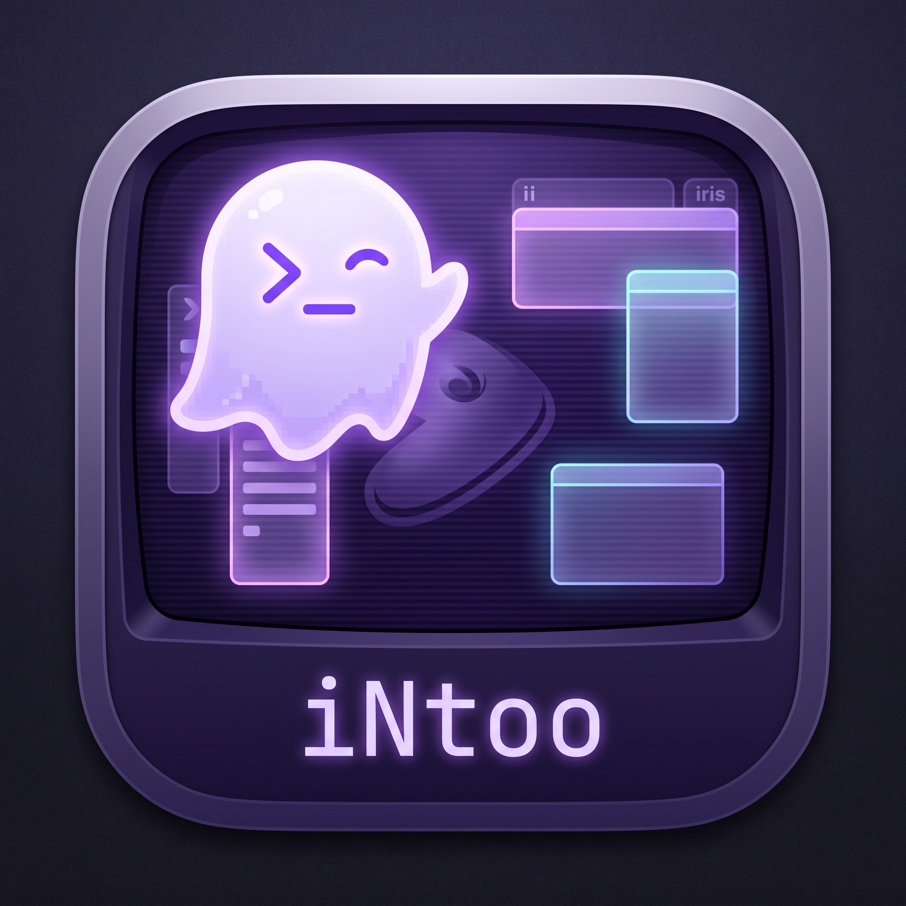
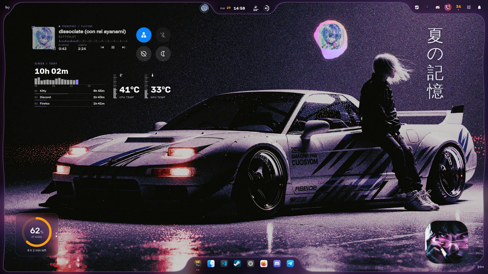

<p align="center">
  
</p>

<h1 align="center">iNtoo</h1>

<p align="center">
  <strong>Полноценная графическая оболочка рабочего стола для композитора Niri на базе Quickshell, адаптированная под Gentoo Linux[cite: 2, 3].</strong>
</p>

<p align="center">
  <a href="https://github.com/D0UP1G/iNtoo/releases"></a>
  <a href="https://github.com/D0UP1G/iNtoo/stargazers"></a>
  <a href="LICENSE"></a>
  <a href="https://github.com/D0UP1G/iNtoo"></a>
</p>

<p align="center">
  <a href="docs/GENTOO.md">Установка в Gentoo</a> &bull;
  <a href="ARCHITECTURE.md">Архитектура</a> &bull;
  <a href="docs/KEYBINDS.md">Горячие клавиши</a> &bull;
  <a href="docs/IPC.md">Справочник IPC</a> &bull;
  <a href="docs/SETUP.md">Настройка и обновления</a>
</p>

<p align="center">
  
</p>

---

## О проекте

* **Основа и назначение:** Проект **iNtoo** основан на оболочке [iNiR](https://github.com/snowarch/inir) от `snowarch` и специально адаптирован для пользователей **Gentoo Linux**[cite: 2, 4].
* **Интеграция с Gentoo:** Проект сохраняет фундамент Quickshell из iNiR, добавляя специализированный установщик и среду выполнения для Gentoo с разрешением зависимостей через **Portage** (конфигурации хранятся в `sdata/dist-gentoo/`) и полноценной поддержкой как **systemd**, так и **OpenRC**[cite: 2, 4].
* **Технологический стек:** Текущая архитектура (версия `2.32.2`) построена с использованием **QML (Quickshell)**, **Bash**, **Python** и **Go**[cite: 3].
* **Независимое развитие:** iNtoo является самостоятельным, независимо поддерживаемым проектом и распространяется по лицензии **GPL-3.0** (сведения об авторстве сохранены в файле [NOTICE](NOTICE))[cite: 2].

---

## Ключевые возможности

* **Три переключаемых семейства интерфейса:** Мгновенное переключение между режимами **Material ii**, **Waffle** и **Island** прямо во время работы по сочетанию клавиш `Super+Shift+W`[cite: 2, 3].
* **Глобальные визуальные стили:** Централизованная система стилей в `Appearance.qml` поддерживает темы `material`, `cards`, `aurora`, `inir`, `angel`, `regalia`, `zzz`, `cookie` и `editorial`[cite: 3].
* **Динамическая темизация от обоев:** Конвейер генерации цветов (`generate_colors_material.py` и `applycolor.sh`) автоматически формирует палитру из выбранных обоев и применяет ее к оболочке и внешним приложениям — терминалам, GTK/KDE, редакторам (включая Zed), Chrome/Chromium, Spicetify, SDDM, Steam, Pear Desktop и Cava[cite: 2, 3].
* **Продвинутая работа с фоном и виджетами:** Три режима выбора обоев (сетка, coverflow и компактный лаунчер) с поддержкой статических изображений, видео, GIF и параллакса, а также размещение виджетов и иконок рабочего стола с сохранением состояния и возможностью отмены действий[cite: 3].
* **Полный набор системных компонентов:** Готовые панели, доки (с поддержкой всех 4 сторон экрана), режим обзора рабочих столов (`Overview`), центр уведомлений, управление медиа с синхронизированными текстами песен (`LyricsService`), микшер громкости PipeWire (`Audio`), инструменты буфера обмена, погода (`Weather`), сеть (`NetworkManager`) и Bluetooth (`BlueZ`)[cite: 2, 3].
* **Встроенный ИИ-компаньон (`Super+S`):** Вызываемый по требованию помощник рабочего стола ([docs/ASSISTANT.md](docs/ASSISTANT.md)) с чатом на базе **OpenCode**, потоковой передачей ответов и настраиваемыми разрешениями на выполнение системных действий[cite: 2, 3].
* **Локализация:** Встроенная система перевода интерфейса (`Translation.qml`) содержит строки для 17 языковых локалей[cite: 3].

---

## Семейства панелей (Panel Families)

Вы можете переключаться между тремя взаимоисключающими вариантами окружения на лету (`Super+Shift+W`)[cite: 3]:

| Характеристика | **Material ii** (`ii`) | **Waffle** (`waffle`) | **Island** (`iris`) |
| :--- | :--- | :--- | :--- |
| **Визуальные токены** | `Appearance.*`[cite: 3] | `Looks.*` (в стиле Windows 11 Fluent)[cite: 3] | `IrisStyle.*` (собственные пресеты и темы)[cite: 3] |
| **Панель (Bar)** | Верхняя или вертикальная (`classic`, `islands`, `scenic`, `frame`, `pill`, `m3`)[cite: 3] | Нижняя панель задач в стиле Windows 11 (`wBar`)[cite: 3] | Плавающий остров на любом краю экрана или зонированная панель во всю ширину (`irisBar`)[cite: 3] |
| **Запуск приложений** | Режим обзора `Overview` с поиском[cite: 3] | Меню пуск `StartMenu` с поиском[cite: 3] | Палитра команд `IrisPalette`[cite: 3] |
| **Боковая / правая панель** | `SidebarRight` (быстрые переключатели, календарь, инструменты) и `SidebarLeft` (ИИ-чат, YT Music)[cite: 3] | `ActionCenter` (быстрые настройки) + `NotificationCenter` (уведомления и календарь)[cite: 3] | Центр управления `IrisControlCenter`[cite: 3] |

---

## Установка и обновление в Gentoo

Установщик настраивает зависимости через **Portage** и поддерживает системы инициализации **systemd** и **OpenRC**[cite: 2].

### Быстрая установка

```bash
git clone [https://github.com/D0UP1G/iNtoo.git](https://github.com/D0UP1G/iNtoo.git)
cd iNtoo
./setup install

```

* **Интерактивный и автоматический режимы:** По умолчанию мастер установки запрашивает подтверждение перед выполнением команд установки зависимостей, но вы можете добавить флаг `-y` (`./setup install -y`) для полностью автоматической установки или запустить интерактивный TUI-установщик командой `./setup`.


* **Установка без пересборки зависимостей:** Если все необходимые пакеты уже установлены в системе, используйте команду `./setup install --skip-deps` для развертывания пользовательской конфигурации.


* **Ручная настройка:** Подробности о ручной установке пакетов, USE-флагах и настройке OpenRC приведены в [руководстве по Gentoo](https://www.google.com/search?q=docs/GENTOO.md).


### Обновление и обслуживание

```bash
./setup update      # Получение изменений из origin, синхронизация, применение миграций и перезапуск сессии
./setup doctor      # Автоматическая диагностика и исправление неполадок
./setup rollback    # Откат к предыдущему снимку состояния

```

* **Сохранность изменений:** Перед запуском `./setup update` рекомендуется зафиксировать (`commit`) или спрятать (`stash`) локальные изменения.


---

## Управление из командной строки (CLI и IPC)

Основная команда управления оболочкой — `intoo` (прежняя команда `inir` также сохранена для обратной совместимости существующих привязок клавиш):

```bash
intoo run                    # Запуск оболочки
intoo restart                # Корректный перезапуск через менеджер сессии (inir.service в systemd или session-supervisor.sh в OpenRC)
intoo status                 # Сводная диагностика установки и состояния репозитория
intoo doctor                 # Автоматическая диагностика и исправление проблем
intoo settings               # Открытие графического интерфейса настроек
intoo logs | tail -50        # Просмотр последних логов для проверки ошибок

# Примеры вызовов IPC
intoo <target> <function> [args...]
intoo overview toggle        # Переключение режима обзора
intoo audio volumeUp         # Увеличение громкости

```

* **Управление жизненным циклом:** Команда `intoo restart` перезапускает оболочку через ее владельца жизненного цикла (`inir.service` на systemd или `scripts/lib/session-supervisor.sh` на OpenRC), благодаря чему запущенные в отдельных сессиях приложения продолжают работать при перезапуске интерфейса.


---

## Документация

| Руководство | Описание |
| --- | --- |
| [Gentoo](https://www.google.com/search?q=docs/GENTOO.md) | Установка, работа с Portage, USE-флаги и настройка OpenRC

 |
| [Install](https://www.google.com/search?q=docs/INSTALL.md) | Параметры установки и первый запуск

 |
| [Setup](https://www.google.com/search?q=docs/SETUP.md) | Обновления, миграции конфигурации и откат состояния

 |
| [Keyboard shortcuts](https://www.google.com/search?q=docs/KEYBINDS.md) | Стандартные сочетания клавиш

 |
| [IPC](https://www.google.com/search?q=docs/IPC.md) | Команды IPC для пользовательских скриптов и привязок клавиш

 |
| [Assistant](https://www.google.com/search?q=docs/ASSISTANT.md) | Настройка и использование ИИ-компаньона (`Super+S`)

 |
| [Packages](https://www.google.com/search?q=docs/PACKAGES.md) | Список зависимостей времени выполнения

 |
| [Architecture](ARCHITECTURE.md) | Подробное описание архитектуры QML-модулей, сервисов и конвейера тем[cite: 3, 4] |

### Миграция на GPUI-shell

Миграция визуальной оболочки планируется на базе GPUI-shell. Использование его исходного кода пока заблокировано до подтверждения лицензии; Quickshell/QML остаётся production-оболочкой и путём отката.

- [PRD миграции](docs/GPUI_SHELL_MIGRATION_PRD.md)
- [Архитектурное решение и статус лицензии](docs/GPUI_SHELL_ARCHITECTURE.md)
- [Критерии приёмки](docs/GPUI_SHELL_MIGRATION_ACCEPTANCE.md)

---

## Происхождение и благодарности

* **Наследие проектов:** **iNtoo** базируется на проекте [iNiR от snowarch](https://github.com/snowarch/inir), который вырос из [illogical-impulse от end-4](https://github.com/end-4/dots-hyprland).


* **Визуальные идеи:** В проекте также отмечены идеи и визуальные наработки из [pctrade/end4-pC](https://github.com/pctrade/end4-pC) и [Ricelin от Gakuseei](https://github.com/Gakuseei/Ricelin).


* **Платформа:** Оболочка работает на базе [Quickshell](https://quickshell.outfoxxed.me/) и спроектирована специально для композитора [Niri](https://github.com/YaLTeR/niri).


* **Лицензия:** Название и айдентика **iNtoo** отделены от проектов iNiR и iRiS; исходное авторство сохранено в файле [NOTICE](https://www.google.com/search?q=NOTICE), а сам проект распространяется на условиях лицензии [GPL-3.0](https://www.google.com/search?q=LICENSE).


